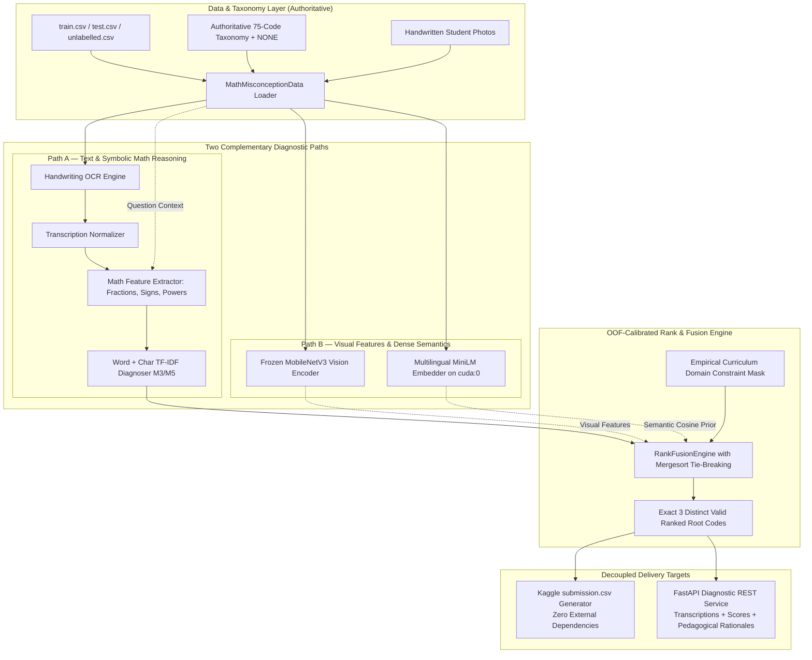

# System Architecture Specification (v2.0)
## Project: Misconception Detection in K-12 Student Math Workings

**Version:** 2.0.0  
**Status:** Validated on 5-Fold Stratified CV & Kaggle Public Leaderboard (0.42916 MAP@3)  
**Governance Standard:** [multi-agent-prompts.md](file:///d:/ag-ai/.agents/rules/multi-agent-prompts.md)  
**Hardware Profile:** NVIDIA GeForce GTX 1050 (4.0 GB VRAM, `cuda:0`, FP16 Mixed Precision)

---

### 1. Decoupled Production & Competition Topology

The system maintains two connected but distinct execution pipelines:
1. **Competition Prediction Path:** Zero-dependency, offline pipeline optimized purely for Kaggle MAP@3. Does not require external APIs, server processes, or network access.
2. **Diagnostic Service API:** FastAPI service exposing transcriptions, calibrated candidate scores, and actionable pedagogical feedback for teachers.



---

### 2. High-Level Modular Decomposition

1. `src/config.py`:
   - Centralized paths, model seeds (42), fold count (5), learning rates, damping factors, and image payload limits.
2. `src/data/`:
   - `dataset.py`: PyTorch / Pandas Dataset loaders handling images, questions, answers, and taxonomy schemas.
   - `taxonomy.py`: Authoritative 75-code taxonomy manager + `NONE` code-to-index mapping.
   - `splits.py`: Reproducible stratified fold generator with rare-class pooling (< 5 samples) and persistent `splits.json` storage.
3. `src/reader/`:
   - `ocr_engine.py`: Handwriting OCR extraction, contrast enhancement, and persistent transcription caching.
   - `transcription_normalizer.py`: Standardizes LaTeX, Indonesian decimal commas, and structured line steps (`L1 | ..., L2 | ...`).
4. `src/diagnoser/`:
   - `question_prior.py`: Strictly in-fold Hierarchical Target Encoder with question-level priors and smooth backoff to (topic, grade) and global classes.
   - `baseline_text.py`: Word + character TF-IDF regularized linear diagnoser.
   - `math_parser.py`: Lightweight symbolic pattern extractor (fractions tops-and-bottoms, sign flips, exponent multiplication).
   - `domain_mask.py`: Curriculum keyword matching, empirical topic affinities, and grade-band calibration.
   - `transformer_embed.py`: GPU-accelerated dense multilingual semantic embedder in FP16 on `cuda:0`.
5. `src/models/`:
   - `vision.py`: MobileNetV3 visual feature extractor and PyTorch classifier head.
   - `train_vision.py`: 5-fold cross-validation trainer for frozen MobileNetV3 visual backbone on `cuda:0`.
   - `finetune_vision.py`: Fine-tuner for top-2 MobileNetV3 blocks with discriminative learning rates (`1e-5` / `1e-3`).
   - `evaluate_honest_oof.py`: Test-like honest out-of-fold cross-validation auditor without gold transcriptions.
   - `evaluate_question_prior.py`: In-fold target encoding evaluator with seen vs. unseen question segmentation and backoff level reporting.
6. `src/fusion/`:
   - `generate_prior_vision_submission.py`: Production submission builder combining 65% Question Prior + 35% Fine-Tuned MobileNetV3 (Public LB: **`0.52199`** 🏆).
   - `multimodal_fuser.py`: Domain-masked late fuser combining visual probabilities with text priors.
   - `ranker.py`: `RankFusionEngine` combining base model scores, applying domain masks, and guaranteeing exactly 3 unique valid codes.
7. `src/metrics/`:
   - `map3.py`: Exact competition MAP@3 calculation and unit tests.
   - `cross_validator.py`: Stratified K-fold cross-validation runner with rare-class pooling.
8. `src/api/`:
   - `schemas.py`: Pydantic V2 schemas with payload size limits, image dimension validation, and distinct code assertions.
   - `service.py`: FastAPI application serving predictions and pedagogical rationales.
9. `src/submission.py`:
   - Standalone submission generator validating row counts, trace alignment, zero NaNs, and taxonomy code validity.

---

### 3. Updated Interface Contracts & OpenAPI 3.0 Schema

```json
{
  "openapi": "3.0.3",
  "info": {
    "title": "K-12 Student Math Misconception Diagnostic API",
    "version": "2.0.0",
    "description": "Pedagogical diagnostic inference engine identifying mathematical root misconceptions in handwritten student workings."
  },
  "paths": {
    "/api/v1/diagnose": {
      "post": {
        "summary": "Diagnose student working from image and problem context",
        "operationId": "diagnoseStudentWorking",
        "requestBody": {
          "required": true,
          "content": {
            "application/json": {
              "schema": {
                "$ref": "#/components/schemas/DiagnosticRequest"
              }
            }
          }
        },
        "responses": {
          "200": {
            "description": "Diagnostic findings and top-3 predicted root misconceptions",
            "content": {
              "application/json": {
                "schema": {
                  "$ref": "#/components/schemas/DiagnosticResponse"
                }
              }
            }
          },
          "422": {
            "description": "Validation error: corrupt image payload, missing required fields, or payload exceeding 10 MB limit"
          }
        }
      }
    }
  },
  "components": {
    "schemas": {
      "DiagnosticRequest": {
        "type": "object",
        "required": ["image_base64"],
        "properties": {
          "trace_id": { "type": "string", "nullable": true, "description": "Optional trace ID; generated if omitted", "example": "tr_9901" },
          "grade": { "type": "integer", "minimum": 1, "maximum": 12, "default": 6, "example": 7 },
          "topic_name": { "type": "string", "default": "mathematics", "example": "fractions" },
          "question_text": { "type": "string", "default": "", "example": "Hitunglah 1/3 + 1/4" },
          "correct_answer": { "type": "string", "nullable": true, "description": "Optional teacher key (handled gracefully if omitted)", "example": "7/12" },
          "image_base64": { "type": "string", "description": "Base64 encoded handwriting image (max 10 MB)" }
        }
      },
      "MisconceptionCandidate": {
        "type": "object",
        "required": ["root_code", "name", "score"],
        "properties": {
          "root_code": { "type": "string", "description": "Valid taxonomy code or NONE", "example": "FRA-01" },
          "name": { "type": "string", "example": "Adding numerators and denominators directly" },
          "nature": { "type": "string", "nullable": true, "example": "procedural" },
          "score": { "type": "number", "description": "Calibrated model confidence score", "example": 0.8842 }
        }
      },
      "DiagnosticResponse": {
        "type": "object",
        "required": ["trace_id", "top_3_predictions", "transcribed_steps", "clean_work"],
        "properties": {
          "trace_id": { "type": "string" },
          "clean_work": { "type": "boolean", "description": "True if NONE is the top-ranked prediction", "example": false },
          "transcribed_steps": { "type": "string", "example": "L1 | 1/3 + 1/4 = 2/7" },
          "top_3_predictions": {
            "type": "array",
            "items": { "$ref": "#/components/schemas/MisconceptionCandidate" },
            "minItems": 3,
            "maxItems": 3,
            "description": "Exactly three distinct, ranked root misconception candidates"
          },
          "pedagogical_feedback": { "type": "string", "example": "Primary finding: student added numerators and denominators straight across." }
        }
      }
    }
  }
}
```

---

### 4. Cross-Validation & Data Leakage Safeguards

1. **Stratified Group Splitting:**
   - Where student IDs exist, partitions group by student while stratifying target codes.
   - When student IDs are unavailable, uses 5-fold Stratified K-Fold with rare-class pooling (< 5 samples) applied solely during fold construction.
   - True ground truth labels are **never** altered or pooled for scoring.
2. **Out-of-Fold Calibration:**
   - All score thresholds, domain mask affinities, and ensemble weights are strictly fitted on out-of-fold base model predictions to eliminate in-sample leakage.
3. **Exact Evaluation Metric:**
   - Exact MAP@3 scoring with deterministic rank tie-breaking and distinct candidate guarantee.
