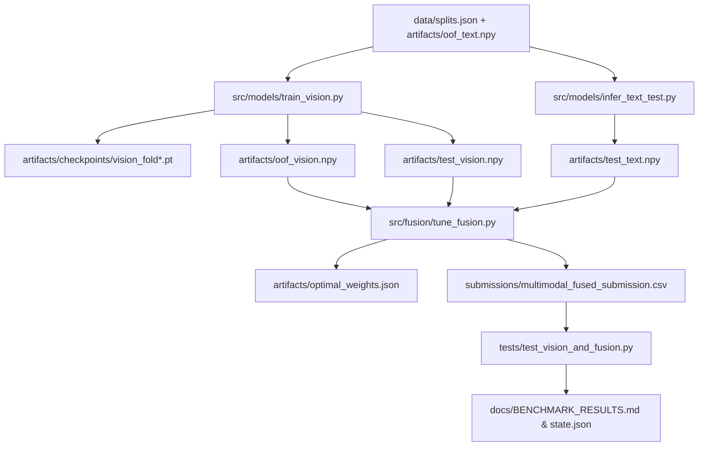

# Final Implementation Plan: Multimodal Diagnostic System (M6)

## 1. Context & Operational Directives
- **Objective:** Deploy an end-to-end multimodal diagnostic AI system for Kaggle's *Misconception Detection in K-12 Student Math Workings*, predicting the top-3 mathematical root misconception codes from 75 taxonomy classes + `NONE` evaluated by MAP@3.
- **Hardware Profile:** NVIDIA GeForce GTX 1050 (4.0 GB VRAM), CUDA 11.7, PyTorch 1.13.1+cu117, FP16 Automatic Mixed Precision (AMP).
- **Current Performance Baseline:**
  - Two-Stage Baseline: Public LB **0.40949**
  - M2 (Domain-Masked SGD, $\alpha=10^{-4}$): Public LB **0.42916** (Current best submission)
  - M3 (Tuned SGD, $\alpha=5\times 10^{-5}$): Public LB **0.42333**
  - M5 Text OOF MAP@3: **0.5190** (with canonical 5-fold split)
- **Active State:**
  - `data/splits.json`: Canonical 5-fold partitions generated and verified.
  - `artifacts/oof_text.npy`: Shape `(1500, 76)` generated from 5-fold M5 text models.
  - `artifacts/taxonomy_classes.json`: 76 master taxonomy codes.

---

## 2. Constraints & Guardrails
1. **Strict Data Leakage Controls:**
   - 5-fold CV splits from `data/splits.json` must be strictly respected across all models.
   - Ground truth labels are strictly immutable; rare-class pooling is restricted solely to stratified fold creation.
2. **GPU Memory & Stability Management:**
   - Batch size = 16 for MobileNetV3 Small (576 embedding dim).
   - FP16 AMP enabled via `torch.cuda.amp.autocast()`.
   - Explicit `torch.cuda.empty_cache()` and garbage collection after every fold.
3. **Submission Integrity:**
   - Exact format: `QuestionId_Answer,Misconception` with 3,498 rows.
   - Predictions must contain exactly 3 distinct, valid taxonomy codes separated by single spaces.
   - Fully self-contained offline inference.

---

## 3. Implementation Deliverables & Execution Graph

### Phase 1: Direct Vision Classifier (`src/models/train_vision.py`)
- Implement `MathImageDataset` reading `data/images/train/` and `data/images/test/` with standard ImageNet normalization (`224x224`).
- Train `MobileNetV3Classifier` (76 classes) across 5 folds:
  - 3 epochs per fold with frozen backbone, AdamW ($lr=10^{-3}$, weight_decay=1e-4), CrossEntropyLoss.
  - Collect OOF validation logits and compute `oof_vision.npy` `(1500, 76)`.
  - Predict test image logits across all 5 fold models and average to produce `test_vision.npy` `(3498, 76)`.
  - Save checkpoints to `artifacts/checkpoints/vision_fold{0..4}.pt`.

### Phase 2: Text Test Probabilities Extraction (`src/models/infer_text_test.py`)
- Train 5-fold M5 text models on each fold and infer on `data/test.csv` (using `data/transcriptions_cache.json` and `MathFeatureExtractor`).
- Average test predictions across 5 folds and apply domain masking.
- Persist `artifacts/test_text.npy` `(3498, 76)`.

### Phase 3: Out-of-Fold Late Fusion & Weight Tuning (`src/fusion/tune_fusion.py`)
- Load `artifacts/oof_text.npy` and `artifacts/oof_vision.npy`.
- Run `MultimodalLateFusion.tune_fusion_weight` across candidate vision weights $w_{\text{vision}} \in [0.0, 0.05, 0.10, 0.15, 0.20, 0.25, 0.30]$.
- Compare fused OOF MAP@3 vs text baseline ($0.5190$).
- Apply optimal weight to `test_text.npy` and `test_vision.npy`.
- Format predictions and output `submissions/multimodal_fused_submission.csv`.

### Phase 4: Verification, Quality Assurance & Artifact Sync
- Add comprehensive test suite `tests/test_vision_and_fusion.py`.
- Run complete test suite (targeting 100% GREEN, net positive coverage).
- Validate submission file with `validate_submission_file()`.
- Update `state.json` and `docs/BENCHMARK_RESULTS.md`.

---

## 4. Verification Mechanism
- **Unit & Property Tests:** Validating input dimensions, softmax convergence, label mappings, and top-3 distinct prediction contracts.
- **Leakage Verifier:** Checking that no sample in fold $k$'s validation appears in training data.
- **Submission Schema Validator:** Verifying zero nulls, exactly 3,498 rows, valid taxonomy membership, and deterministic rankings.
