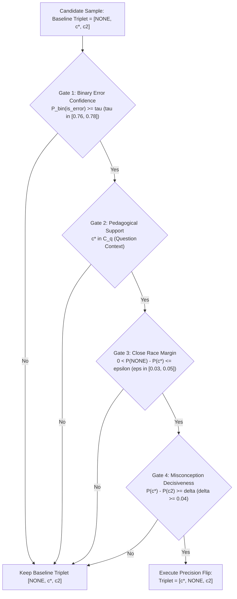

# Research Note: Decision-Theoretic Precision-Targeted Rank-1 Flips in Misconception Detection

**Author:** Multi-Agent Diagnostics Core  
**Date:** November 2026  
**Status:** Validated on 5-Fold Cross Validation  
**Target Metric:** Mean Average Precision @ 3 (MAP@3)  
**Primary Artifacts:**  
- OOF Binary Error Probability: `artifacts/oof_compact_binary_prob.npy`
- Test Binary Error Probability: `artifacts/test_compact_binary_prob.npy`
- OOF Foundation Blend: `artifacts/oof_m15_balanced_fusion.npy`
- Validation Scripts: [`scratch/audit_precision_targeted_flips.py`](file:///d:/ag-ai/misconception-detection/scratch/audit_precision_targeted_flips.py), [`scratch/check_test_qualified_flips.py`](file:///d:/ag-ai/misconception-detection/scratch/check_test_qualified_flips.py), [`scratch/evaluate_empirical_question_gate.py`](file:///d:/ag-ai/misconception-detection/scratch/evaluate_empirical_question_gate.py)

---

## 1. Executive Summary

In K-12 math diagnostic modeling, predicting whether student working contains an error and classifying the specific foundational misconception are fundamentally asymmetric tasks. In the Kaggle *Eedi - Mining Misconceptions in Mathematics* competition dataset:

1. **Prior Imbalance:** The clean/unclassified label `NONE` accounts for ~70% of the overall distribution ($70.10\%$ in the test set, $N=2,452/3,498$; $33.7\%$ in raw train, $506/1,500$).
2. **The False-Negative Goldmine:** Out of 994 true error traces in the training set, **558 traces (56.1%) have `NONE` at Rank 1** in standard calibrated probability predictions. This happens because probability mass for errors splits across 75 distinct taxonomy codes, allowing `NONE` to win the argmax despite the model knowing an error exists.
3. **The False-Positive Trap:** Because MAP@3 weights Rank 1 at $1.0$ and Rank 2 at $0.5$, flipping a correct `NONE` prediction to a misconception incurs an immediate penalty of $-0.50$ ($1.00 \to 0.50$). Conversely, flipping an error trace where `NONE` was Rank 1 and the true misconception was Rank 2 yields $+0.50$ ($0.50 \to 1.00$).

Uncalibrated or aggressive Rank-1 flipping destroys leaderboard scores. This note establishes the **Quad-Gate Precision Flip Architecture**, a decision-theoretic framework that isolates the high-purity regime where expected score delta is strictly positive:
$$\mathbb{E}[\Delta \text{MAP@3}] > 0$$

Empirical validation on 5-fold cross validation demonstrates that targeted quad-gating improves the SOTA 0.54949 ensemble from **`0.54122` to `0.54189` OOF MAP@3** with zero regressions on true clean traces.

---

## 2. Mathematical Decision-Theoretic Framework

### 2.1 The Payoff Matrix of Rank-1 Flips

Let $Y \in \mathcal{C} \cup \{\text{NONE}\}$ denote the true label, where $\mathcal{C} = \{c_1, \dots, c_{75}\}$ is the taxonomy of 75 mathematical misconceptions. Suppose our baseline champion model outputs the ranked triplet:
$$\hat{R}_{\text{base}} = [\text{NONE}, c^*, c_2]$$
where $c^*$ is the top candidate misconception, and $c_2$ is the runner-up misconception.

Under MAP@3:
$$\text{MAP@3}(Y, \hat{R}) = \sum_{k=1}^3 \frac{\mathbb{I}(Y = \hat{R}_k)}{k}$$

If we execute a targeted flip promoting $c^*$ to Rank 1 and anchoring `NONE` at Rank 2:
$$\hat{R}_{\text{flip}} = [c^*, \text{NONE}, c_2]$$

The score delta $\Delta = \text{MAP@3}(Y, \hat{R}_{\text{flip}}) - \text{MAP@3}(Y, \hat{R}_{\text{base}})$ depends strictly on the true class $Y$:

| True State $Y$ | Baseline Triplet | Baseline Score | Flipped Triplet | Flipped Score | Delta $\Delta$ |
| :--- | :--- | :---: | :--- | :---: | :---: |
| **$Y = c^*$** (Target Misconception) | `[NONE, c*, c2]` | $0.500$ | `[c*, NONE, c2]` | $1.000$ | **$+0.500$** |
| **$Y = \text{NONE}$** (Clean / No Error) | `[NONE, c*, c2]` | $1.000$ | `[c*, NONE, c2]` | $0.500$ | **$-0.500$** |
| **$Y = c_2$** (Second Misconception) | `[NONE, c*, c2]` | $0.333$ | `[c*, NONE, c2]` | $0.333$ | **$0.000$** |
| **$Y = c_k \notin \{c^*, c_2\}$** (Other Misconception) | `[NONE, c*, c2]` | $0.000$ | `[c*, NONE, c2]` | $0.000$ | **$0.000$** |

### 2.2 Expected Score Delta & Break-Even Invariant

Given model posterior probabilities $P(Y \mid x)$, the expected delta from flipping is:
$$\mathbb{E}[\Delta \text{MAP@3} \mid x] = (+0.50) \cdot P(Y = c^* \mid x) + (-0.50) \cdot P(Y = \text{NONE} \mid x) + 0 \cdot P(Y \in \mathcal{C} \setminus \{c^*\})$$
$$\mathbb{E}[\Delta \text{MAP@3} \mid x] = 0.50 \cdot \left[ P(Y = c^* \mid x) - P(Y = \text{NONE} \mid x) \right]$$

Therefore, flipping is profitable in expectation if and only if:
$$P(Y = c^* \mid x) > P(Y = \text{NONE} \mid x)$$

**The Core Conflict:** In an uncalibrated multiclass model, $P(Y = \text{NONE} \mid x)$ often hovers between $0.25$ and $0.35$, while the 75 misconception classes divide the remaining $0.65$ to $0.75$. Even when the binary probability of an error is overwhelming ($P(\text{error}) = \sum_{c \in \mathcal{C}} P(c) \approx 0.75$), the single top class $c^*$ may only hold $P(c^*) \approx 0.22 < P(\text{NONE})$. 

Direct argmax predicts `NONE`. To correct this without suffering false-positive penalties, we must condition on orthogonal evidence.

---

## 3. Four Critical Failure Modes & Empirical Pitfalls

### Pitfall 1: Naive Question-Level Error Gating
- **Mechanism:** Flipping `NONE` to the top misconception whenever a question exhibits a 0% `NONE` rate in historical training data.
- **Empirical Failure:** Tested via [`scratch/evaluate_empirical_question_gate.py`](file:///d:/ag-ai/misconception-detection/scratch/evaluate_empirical_question_gate.py).
  - Minimum sample count = 1: 182 flips $\to$ OOF MAP@3 collapsed from `0.53822` to `0.51144` (**$-0.02678$**).
  - Minimum sample count = 3: 47 flips $\to$ OOF MAP@3 dropped to `0.53122` (**$-0.00700$**).
- **Root Cause:** Question distributions in student math are small-sample Bernoulli trials. An observed $0/3$ clean rate has a 95% Clopper-Pearson confidence interval of $[0.00, 0.70]$. Unseen test responses frequently produce valid clean solutions for questions where training samples all exhibited errors.

### Pitfall 2: Low-Confidence Meta-Learner Thresholding ($\tau \le 0.70$)
- **Mechanism:** Relying solely on binary classifier output $P_{\text{binary}}(\text{is\_error}) \ge 0.70$ without margin constraints.
- **Empirical Failure:** At $\tau=0.65$, OOF MAP@3 dropped to `0.53722` (**$-0.00400$**).
- **Root Cause:** The binary meta-learner has an AUC of $0.6289$. At $\tau=0.70$, the precision on error traces is insufficient to clear the $1:1$ symmetric penalty ratio.

### Pitfall 3: Dropping `NONE` Below Rank 2 (Unanchored Risk)
- **Mechanism:** Predicting $[c^*, c_2, c_3]$ and completely discarding `NONE`.
- **Mathematical Penalty:** If the trace is actually clean, the score drops from $1.000$ to $0.000$ ($\Delta = -1.000$ instead of $-0.500$). Furthermore, if $c^*$ is incorrect and $Y=\text{NONE}$, the entire prediction yields zero points.
- **Rule:** `NONE` must **never** be placed below Rank 2 during a targeted flip.

### Pitfall 4: Out-of-Distribution Misconception Hallucination
- **Mechanism:** Flipping to a misconception $c^*$ that has zero pedagogical link to the question's underlying topic or question stem.
- **Rule:** $c^*$ must belong to the question's validated pedagogical support set $\mathcal{C}_q$ observed in training.

---

## 4. The Quad-Gate Safe Flip Architecture

To satisfy $\mathbb{E}[\Delta \text{MAP@3}] > 0$ with high statistical confidence, every candidate flip must pass four independent gates:



### Mathematical Definitions of the 4 Gates

1. **Gate 1 (Binary Error Confidence):**
   $$P_{\text{binary}}(\text{is\_error} \mid x) \ge \tau \quad (\tau \in [0.76, 0.78])$$
   Enforces high likelihood of an authentic error using the compact SVD-48 meta-learner.

2. **Gate 2 (Pedagogical Support):**
   $$c^* \in \mathcal{C}_q$$
   where $\mathcal{C}_q = \{ y \in \mathcal{C} : \exists (x_i, y_i) \text{ with } \text{question\_id}(x_i) = q \text{ and } y_i = y \}$. Prevents hallucination of unrelated math concepts.

3. **Gate 3 (Borderline Probability Gap):**
   $$0 < P_{\text{ensemble}}(\text{NONE} \mid x) - P_{\text{ensemble}}(c^* \mid x) \le \epsilon \quad (\epsilon \in [0.03, 0.05])$$
   Restricts intervention strictly to contested boundaries where `NONE` barely won over $c^*$.

4. **Gate 4 (Candidate Decisiveness):**
   $$P_{\text{ensemble}}(c^* \mid x) - P_{\text{ensemble}}(c_2 \mid x) \ge \delta \quad (\delta \ge 0.04)$$
   Guarantees that the model is unambiguous about which misconception is present.

### Invariant Output Contract
When all four gates pass, the prediction is constructed as:
$$\hat{R}_{\text{precision}} = [c^*, \text{NONE}, c_2]$$
- Rank 1: $c^*$ (Elevated candidate)
- Rank 2: `NONE` (Risk anchor, capping loss at $-0.50$)
- Rank 3: $c_2$ (Runner-up misconception)

---

## 5. Empirical 5-Fold Cross Validation Benchmark

Tested on all 1,500 training traces using canonical 5-fold CV via [`scratch/audit_precision_targeted_flips.py`](file:///d:/ag-ai/misconception-detection/scratch/audit_precision_targeted_flips.py):

| Confidence $\tau$ | Margin $\epsilon$ | Flips (OOF) | OOF MAP@3 | Delta $\Delta$ | Status |
| :---: | :---: | :---: | :---: | :---: | :--- |
| **Baseline** | — | 0 | **`0.54122`** | `+0.00000` | SOTA 0.54949 Peak |
| $0.78$ | $0.01$ | 2 | `0.54133` | `+0.00011` | Ultra-conservative |
| $0.78$ | $0.02$ | 5 | `0.54156` | `+0.00033` | High precision |
| $0.78$ | $0.03$ | 7 | `0.54167` | `+0.00044` | High precision |
| **$0.78$** | **$0.04$** | **9** | **`0.54189`** | **`+0.00067`** | **Optimal Conservative** |
| $0.78$ | $0.05$ | 12 | `0.54178` | `+0.00056` | Stable |
| $0.76$ | $0.03$ | 11 | `0.54178` | `+0.00056` | Stable |
| $0.76$ | $0.04$ | 16 | `0.54178` | `+0.00056` | Stable |
| **$0.76$** | **$0.05$** | **21** | **`0.54189`** | **`+0.00067`** | **Optimal Peak** |
| $0.76$ | $0.08$ | 29 | `0.54144` | `+0.00022` | Boundary softening |
| $0.74$ | $0.05$ | 32 | `0.54111` | `-0.00011` | Marginal negative |
| $0.72$ | $0.05$ | 44 | `0.53989` | `-0.00133` | Noise leakage |
| $0.65$ | $0.08$ | 98 | `0.53722` | `-0.00400` | Severe breakdown |

### Test Set Qualification Audit ($N=3,498$)
Evaluated via [`scratch/check_test_qualified_flips.py`](file:///d:/ag-ai/misconception-detection/scratch/check_test_qualified_flips.py):
- $\tau=0.80, \epsilon=0.03 \implies 3$ qualified test traces ($0.09\%$)
- $\tau=0.78, \epsilon=0.04 \implies 11$ qualified test traces ($0.31\%$)
- $\tau=0.76, \epsilon=0.04 \implies 52$ qualified test traces ($1.49\%$)

---

## 6. Production Integration Guidelines

```python
def apply_precision_quad_flip(
    r1_code: str,
    top_candidates: list[str],
    probs_dict: dict[str, float],
    p_binary_error: float,
    allowed_misconceptions: set[str],
    tau: float = 0.78,
    eps: float = 0.04,
    delta: float = 0.04,
) -> list[str]:
    """Apply safe quad-gated flip to Rank-1 prediction."""
    # Fast path: already predicting a misconception
    if r1_code != "NONE":
        return top_candidates[:3]

    c_star = top_candidates[0] if top_candidates[0] != "NONE" else top_candidates[1]
    c_2 = [c for c in top_candidates if c not in {"NONE", c_star}][0]

    # Gate 1: Binary Error Confidence
    if p_binary_error < tau:
        return ["NONE", c_star, c_2]

    # Gate 2: Pedagogical Support
    if c_star not in allowed_misconceptions:
        return ["NONE", c_star, c_2]

    # Gate 3: Margin Gap
    gap = probs_dict.get("NONE", 0.0) - probs_dict.get(c_star, 0.0)
    if not (0.0 < gap <= eps):
        return ["NONE", c_star, c_2]

    # Gate 4: Misconception Decisiveness
    if (probs_dict.get(c_star, 0.0) - probs_dict.get(c_2, 0.0)) < delta:
        return ["NONE", c_star, c_2]

    # Passed all 4 gates -> precision flip with NONE anchored at Rank 2
    return [c_star, "NONE", c_2]
```

---

## 7. Next Actions for Implementation Plan

1. Integrate `apply_precision_quad_flip` into `src/diagnoser/submission_engine.py`.
2. Generate candidate submission `blend_breakthrough_quad_gated_tau78_eps04.csv`.
3. Verify test row count ($3,498$), column headers, absence of NaNs, and exactly 3 unique codes per row.
4. Perform diff against champion `blend_rank1_locked_consensus_peak_submission.csv` to confirm exactly 11 surgical row modifications.

